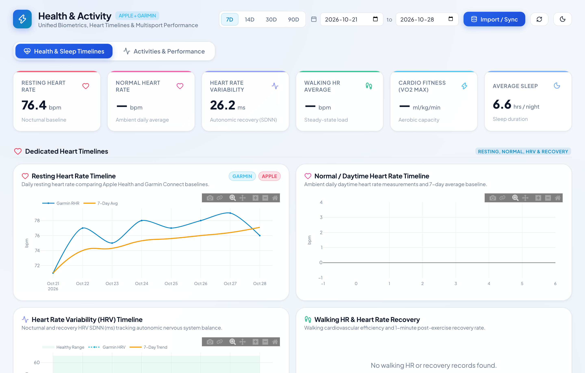
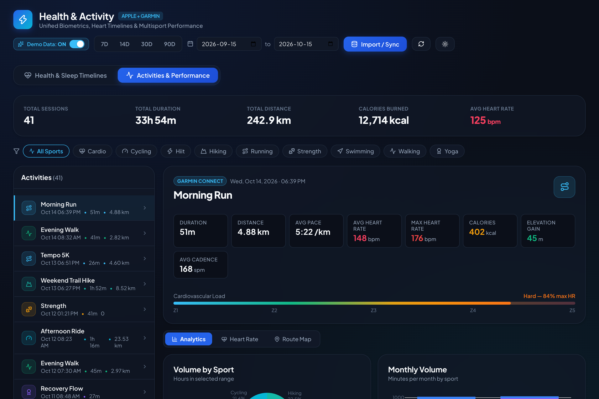
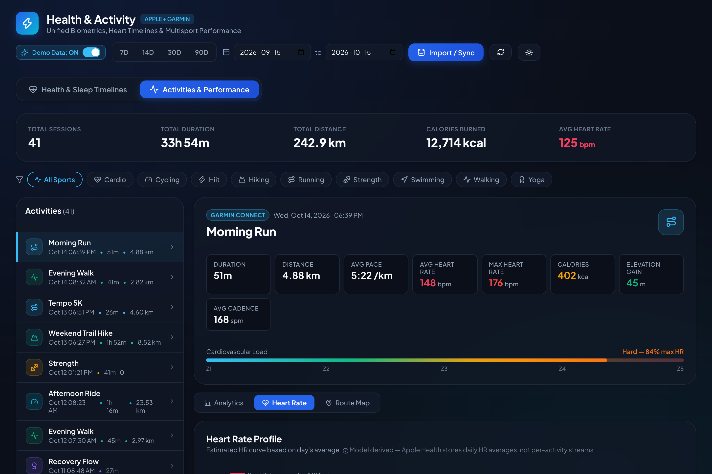
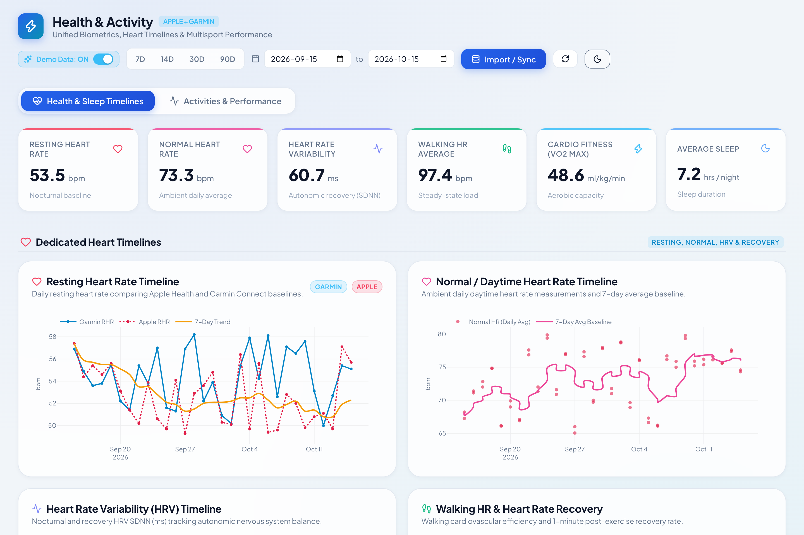

# Health & Activity Dashboard (Apple Health + Garmin)

A unified local health analytics and multisport activity dashboard combining data from **Apple Health** and **Garmin Connect**.

Built with **FastAPI**, **SQLite**, **React**, **TypeScript**, and **Plotly.js**, featuring an oceanic blue design system inspired by Apple Health and Athlytics.

---

## 📸 Screenshots & Demo Preview

### Health & Sleep Timelines (Dark Mode)
*Unified biometrics overlaying Apple Health and Garmin data with VO2 Max fitness trends, Resting HR, HRV, sleep stages architecture, consistency, and wrist temperature.*


### Activities & Multisport Performance
*Activity inspection feed, volume distribution donut by sport, monthly training time breakdown, and comprehensive metrics.*


### Per-Activity Heart Rate Profile & Zones
*Session-specific heart rate curve with cardiovascular intensity zones (Recovery, Aerobic, Threshold, VO2Max) and load indicators.*


### Light Theme
*Clean, high-contrast light mode with custom oceanic & slate color palette.*


---

## ⚡ Key Features

### 1. Health & Sleep Timelines
- **Unified Biometrics**: Dual-source overlay combining Resting Heart Rate (RHR) and Heart Rate Variability (HRV) from both Apple Health and Garmin.
- **Sleep Architecture**: Nightly breakdown of **Deep**, **REM**, **Light / Core**, and **Awake** stages with target sleep window benchmarks.
- **Health KPIs**: Average Resting Heart Rate, HRV, Cardio Fitness (VO2 Max), Sleep Duration, Total Steps, and Active Energy.
- **Time Range Presets**: 7D, 14D, 30D, 90D, or custom calendar ranges.

### 2. Multisport Activities & Performance
- **Activity Selector**: Filter by sport category (**Running**, **Cycling**, **Swimming**, **Walking**, **Strength**, **Hiking**, **Yoga**).
- **Session Inspector**: Click any session to inspect detailed metrics:
  - Duration, Distance, Calories, Pace/Speed, Heart Rate (Avg & Max), Cadence, Power, Elevation gain/loss.
  - Cardiovascular load intensity indicator.
- **Training Volume**: Distribution of training hours by sport type.

### 3. Data Ingestion & Live Connection
- **Apple Health Archive**: Stream-parse Apple Health `export.zip` (or uncompressed `export.xml`) with memory-efficient iterparse directly from local path (e.g. `~/Downloads/export.zip`).
- **Garmin Personal API Key Sync (Recommended)**: Official passwordless live sync using self-generated Garmin Developer Personal API keys (`GCDC_...`) from [connect.garmin.com/app/settings](https://connect.garmin.com/app/settings). Directly pulls full activity history, daily metrics (steps, active calories, resting HR), sleep architecture (deep, light, REM, awake), and HRV without MFA/passcode prompts.
- **Garmin Connect Login**: Legacy credential sync with automated MFA security passcode verification.
- **One-Click Demo Data**: Seed 45 days of realistic multi-source sample data for immediate local exploration.

---

## 🚀 Quick Start

### 1. Requirements
- Python 3.10+ (managed via `uv` or standard venv)
- Node.js 18+ and npm

### 2. Run Dashboard

```bash
# Start both backend (FastAPI :8001) and frontend (Vite :5173)
./scripts/run.sh
```

- Open **Frontend**: [http://localhost:5173](http://localhost:5173)
- API Documentation: [http://localhost:8001/docs](http://localhost:8001/docs)

---

## 📂 Project Structure

```
health-activity-dashboard-apple-garmin/
├── backend/
│   ├── database.py              # SQLite storage & queries (metrics, activities, sleep)
│   ├── garmin_provider.py       # Garmin Connect client & live sync
│   ├── apple_health_provider.py # Streaming Apple Health XML parser
│   ├── server.py                # FastAPI routes for health, sleep, activities & import
│   └── seed.py                  # Sample multi-source generator
├── frontend/
│   ├── src/
│   │   ├── api/client.ts        # Typed API client
│   │   ├── components/
│   │   │   ├── Header.tsx       # Date range selector, presets, theme toggle
│   │   │   ├── HealthTab.tsx    # Dual-source heart & sleep timelines
│   │   │   ├── ActivityTab.tsx  # Multisport selector & session inspector
│   │   │   ├── ImportModal.tsx  # Apple Health & Garmin Live sync modal
│   │   │   ├── KpiCard.tsx      # Metric cards with accent borders
│   │   │   └── PlotlyChart.tsx  # Responsive themed Plotly wrapper
│   │   └── theme/
│   │       ├── colors.ts        # Slate & oceanic design tokens
│   │       └── styles.css       # Responsive glassmorphic layout
│   └── package.json
├── data/                        # Local SQLite database
├── .garmin_tokens/              # Local OAuth token cache for Garmin
├── scripts/
│   └── run.sh                   # Dev startup script
└── pyproject.toml
```

---

## 📊 Importing Your Data

1. Click the **"Import / Sync"** button in the dashboard top navigation.
2. Choose one of the following:
   - **Apple Health**: Provide the path to your `export.zip` (e.g., `~/Downloads/export.zip`) and click **Start Import**.
   - **Garmin Live Sync**: Enter your Garmin email and password, choose the days to sync (14, 30, 60, or 90 days), and click **Connect & Sync**.
   - **Demo Data**: Click **Load 45 Days Demo Data** to immediately test and explore the interface.

---

## 🎛️ Demo Mode Toggle

A **Demo Data: [ON | OFF]** switch is located at the top of the header:
- **OFF (Default)**: Clears all sample/demo records from the database, leaving only your real imported data.
- **ON**: Populates 45 days of realistic multi-source Apple Health and Garmin data (heart rate, HRV, VO2 Max, sleep stages, wrist temperature, running, cycling, swimming, etc.) so you can test and explore features immediately.

---

## 📄 License & Commercial Use

This software is licensed under the **[PolyForm Noncommercial License 1.0.0](LICENSE)**.

- **Non-Commercial & Personal Use**: You are free to run, study, fork, modify, and test this software for personal health tracking, academic study, and non-commercial evaluation free of charge.
- **Commercial Use Requires a Paid License**: Any commercial use, redistribution, inclusion in commercial SaaS/applications, deployment for business operations, or paid services requires prior written permission and an agreed commercial licensing agreement with payment.
- **Commercial Licensing Inquiries**: Please contact **Harpreet Singh Kundhal** at [hskundhal@gmail.com](mailto:hskundhal@gmail.com).
